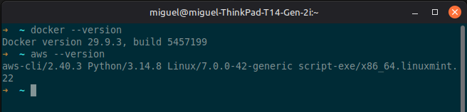
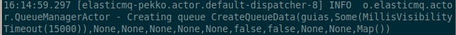

# Mensageria
Atividade individual 2 | Infraestrutura de Software | ADS - CESAR School - 2026.2

## Passos
### 1. Instalar as ferramentas
Instalei AWS CLI v2 e a biblioteca boto3 para python (usando venv). O restante já estava instalado.

### 2. Subir a fila
ElasticMQ rodando no docker.

Configurando as variaveis de ambiente e criando a sqs queue com o aws cli.

### 3-4. consumidor.py e produtor.py
Criados e colocados na pasta src (pra ficar organizadinho).

### 5.1 Um consumidor
Com um consumidor todas as guias produzidas sao consumidas por ele, na ordem (R-001 a R-020). A mensagem invalida volta pra fila e o `ApproximateReceiveCount` sobe a cada tentativa (1, 2, 3, 4, 5).

### 5.2 Dois consumidores
Com dois consumidores, nesse teste as mensagens se dividiram uma pra cada:

| PID | requisicoes processadas | total |
|---|---|---|
| 55833 | R-001, 003, 005, 007, 009, 011, 013, 015, 017, 019 | 10 |
| 56283 | R-002, 004, 006, 008, 010, 012, 014, 016, 018, 020 | 10 |

Cada consumidor viu as suas em ordem, mas a ordem geral nao foi mantida (ficou intercalada entre os dois). A divisao certinha foi o que aconteceu aqui, nao uma garantia da fila.

Nao limpei a fila entre o 5.1 e o 5.2, entao a invalida do 5.1 continuou rodando (contador 6 a 11, passando pelos dois consumidores) e o produtor colocou uma invalida nova (contador comecando em 1).

#### um experimento
Com tres consumidores (os dois anteriores mais um novo), o comportamento se mantem: as mensagens se dividiram de tres em tres.

| PID | requisicoes processadas | total |
|---|---|---|
| 56283 | R-001, 004, 007, 010, 013, 016, 019 | 7 |
| 55833 | R-002, 005, 008, 011, 014, 017, 020 | 7 |
| 57442 | R-003, 006, 009, 012, 015, 018 | 6 |

Como rodei o produtor de novo sem limpar a fila, ja tinha mais de uma mensagem invalida girando ao mesmo tempo (por isso o mesmo terminal mostra contadores 41-44 e depois 35-38: sao mensagens diferentes). Sem DLQ, elas nunca saem da fila.

