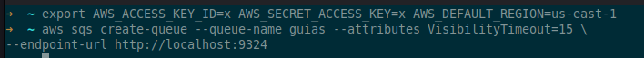
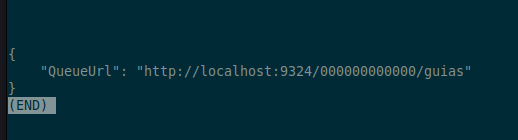
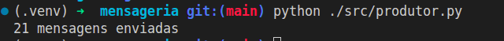

# Messageria
Atividade individual 2 | Infraestrutura de Software | ADS - CESAR School - 2026.2

## Passos
### 1. Instalar as ferramentas
Instalei AWS CLI v2 e a biblioteca boto3 para python (usando venv). O restante já estava instalado.

### 2. Subir a fila
ElasticMQ rodando no docker.

Configurando as variaveis de ambiente e criando a sqs queue com o aws cli.

### 3-4. consumidor.py e produtor.py
Criados oe colocados na pasta src (pra ficar organizadinho).

### 5.1 Um consumidor
Com um consumidor todas as guias produzidas sao consumidas por ele.

### 5.2 Dois consumidores
Com dois consumidores, as mensagens sao distribuidas alternadamente entre eles.

#### um experimento
Com tres consumidores, o comportamento se mantem.
