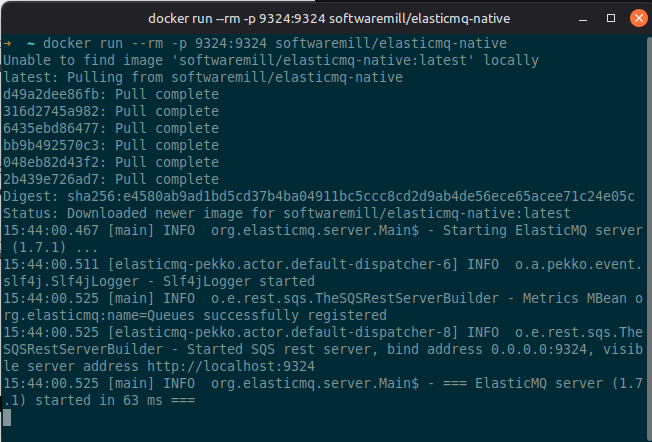
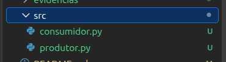
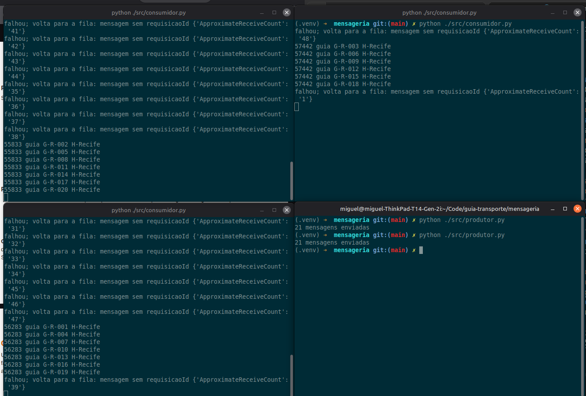

# Mensageria
Atividade individual 2 | Infraestrutura de Software | ADS - CESAR School - 2026.2

## Perguntas

**1. Por que o consumidor só apaga a mensagem depois de processar? O que aconteceria se apagasse antes?**

Se o consumidor apagasse a mensagem logo ao receber e caisse antes de terminar (erro, queda de energia, ctrl+c), **a mensagem se perderia silenciosamente**: a guia nunca seria emitida e ninguem ia saber. o delete_message() é a confirmacao de que deu certo, entao ele so pode vir depois do processamento. Se a confirmacao nao vem, a mensagem continua na fila e reaparece depois do visibility timeout.

**2. Com dois consumidores, como as mensagens se dividiram? A ordem foi mantida? O que a documentação do SQS diz sobre ordem nas filas padrão?**

nesse teste as mensagens se dividiram igualmente: 10 pra cada, impares num e pares no outro (ver tabela no [5.2](#52-dois-consumidores)). com tres consumidores ficou 7/7/6. a fila entregou em ordem (R-001, R-002, R-003...) e cada consumidor processou as suas em ordem, mas como eles rodam em paralelo a **ordem geral de processamento nao é garantida**, ficou intercalada.

na documentacao do SQS, a fila padrao tenta manter a ordem quando possivel (best-effort ordering), mas as mensagens podem chegar fora de ordem ou repetidas por causa da arquitetura altamente distribuida.

https://docs.aws.amazon.com/pt_br/AWSSimpleQueueService/latest/SQSDeveloperGuide/standard-queues.html

**3. A fila padrão garante entrega pelo menos uma vez, e a mesma mensagem pode chegar duas vezes. O que isso exige do consumidor? Como vocês o tornariam idempotente?**

Como a mesma mensagem pode chegar mais de uma vez, o consumidor tem que ser idempotente: processar a mesma mensagem duas vezes tem que ter o mesmo efeito que processar uma. no rota vital, sem isso, poderiam sair duas guias pra mesma requisicao (transporte duplicado de hemocomponente).

Todo consmidor poderia checar se uma guia ja foi processada consultando um banco que salva o id das guias que ja foram consumidas. Caso seja algo muito critico, poderiamos usar uma tecnica de deduplicacao com ID, como especificado na [documentação do SQS](https://docs.aws.amazon.com/pt_br/AWSSimpleQueueService/latest/SQSDeveloperGuide/using-messagededuplicationid-property.html) em uma fila FIFO.

**4. Expliquem o visibility timeout com o que viram na mensagem inválida. Para que serve uma DLQ?**

Quando um consumidor recebe a mensagem, ela nao sai da fila: fica invisivel pros outros pelo visibility timeout (15 s na nossa fila, da pra ver o MillisVisibilityTimeout(15000) no log do ElasticMQ). isso evita que dois consumidores processem a mesma mensagem ao mesmo tempo. se o tempo passar sem delete_message(), ela fica visivel de novo, e assim a mensagem nao se perde se o consumidor morrer. com a mensagem invalida deu pra ver isso: ela reaparecia a cada ~15 s, o ApproximateReceiveCount subia e ela pulava de um consumidor pro outro.

O problema é que uma mensagem que nunca vai dar certo fica girando pra sempre. no meu experimento, sem limpar a fila, ficaram varias invalidas girando ao mesmo tempo, com contador chegando a 48, gastando os consumidores a toa. a DLQ (dead-letter queue) resolve isso: configura um limite de tentativas (maxReceiveCount, por exemplo 3) e, passou disso, a mensagem vai pra outra fila em vez de voltar, ficando separada pra alguem investigar.

**5. No Rota Vital, qual a diferença entre o hospital chamar a emissão de guia diretamente (síncrono) e passar por uma fila (assíncrono)? O que se ganha e o que se perde?**

Na atividade 1 o hospital chamava a emissao direto (POST /guias) e recebia a guia na resposta. isso é sincrono: a resposta é imediata e simples, mas exige que tudo funcione naquele momento. Se o servico de guias estiver fora do ar ou lento, o pedido do hospital falha ou fica travado esperando, e num pico de requisicoes (um acidente com muita demanda de sangue, por exemplo) o servico pode nao dar conta.

Com a fila o hospital so publica o pedido e segue.

O que se ganha: o pedido nao se perde mesmo se o servico de guias cair, ele fica guardado na fila até alguem processar; picos ficam acumulados na fila em vez de derrubar o servico; e da pra colocar mais consumidores pra dividir o trabalho, como vi nos testes com 2 e 3 consumidores.

O que se perde: o imediatismo, o hospital nao recebe a guia na hora e precisa de outro jeito de saber se ela saiu ou falhou (talvez receber uma notificacao); entram os problemas de ordem e de mensagem duplicada (perguntas 2 e 3); e é mais uma peca de infraestrutura pra manter e depurar.

## Passos e evidencias
### 1. Instalar as ferramentas
Instalei AWS CLI v2 e a biblioteca boto3 para python (usando venv). O restante já estava instalado.

### 2. Subir a fila
ElasticMQ rodando no docker.

Configurando as variaveis de ambiente e criando a sqs queue com o aws cli.

### 3-4. consumidor.py e produtor.py
Criados e colocados na pasta src (pra ficar organizadinho).

### 5.1 Um consumidor
Com um consumidor todas as guias produzidas sao consumidas por ele, na ordem (R-001 a R-020). A mensagem invalida volta pra fila e o `ApproximateReceiveCount` sobe a cada tentativa (1, 2, 3, 4, 5).

### 5.2 Dois consumidores
Com dois consumidores, nesse teste as mensagens se dividiram uma pra cada:

| PID | requisicoes processadas | total |
|---|---|---|
| 55833 | R-001, 003, 005, 007, 009, 011, 013, 015, 017, 019 | 10 |
| 56283 | R-002, 004, 006, 008, 010, 012, 014, 016, 018, 020 | 10 |

Cada consumidor viu as suas em ordem, mas a ordem geral nao foi mantida (ficou intercalada entre os dois). A divisao certinha foi o que aconteceu aqui, nao uma garantia da fila.

Nao limpei a fila entre o 5.1 e o 5.2, entao a invalida do 5.1 continuou rodando (contador 6 a 11, passando pelos dois consumidores) e o produtor colocou uma invalida nova (contador comecando em 1).

#### um experimento
Com tres consumidores (os dois anteriores mais um novo), o comportamento se mantem: as mensagens se dividiram de tres em tres.

| PID | requisicoes processadas | total |
|---|---|---|
| 56283 | R-001, 004, 007, 010, 013, 016, 019 | 7 |
| 55833 | R-002, 005, 008, 011, 014, 017, 020 | 7 |
| 57442 | R-003, 006, 009, 012, 015, 018 | 6 |

Como rodei o produtor de novo sem limpar a fila, ja tinha mais de uma mensagem invalida girando ao mesmo tempo (por isso o mesmo terminal mostra contadores 41-44 e depois 35-38: sao mensagens diferentes). Sem DLQ, elas nunca saem da fila.

